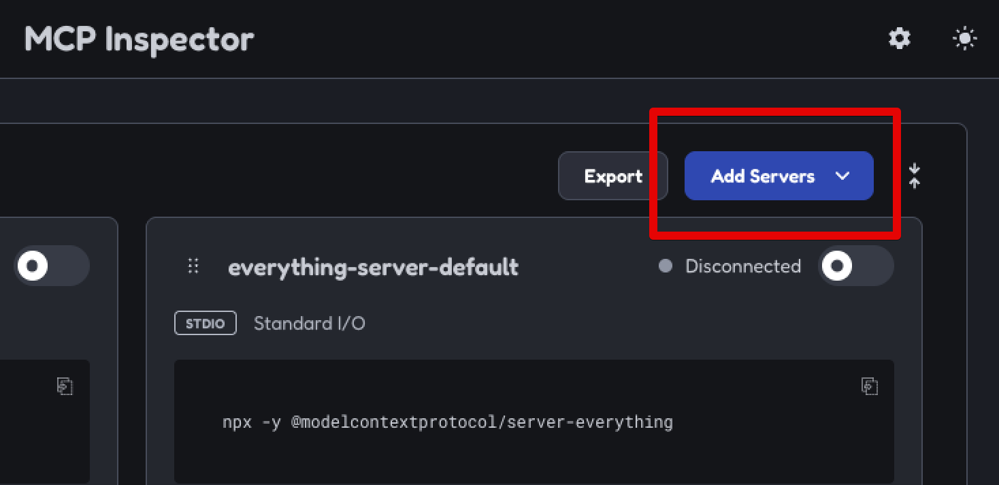
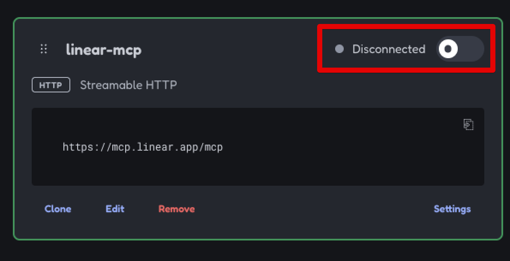
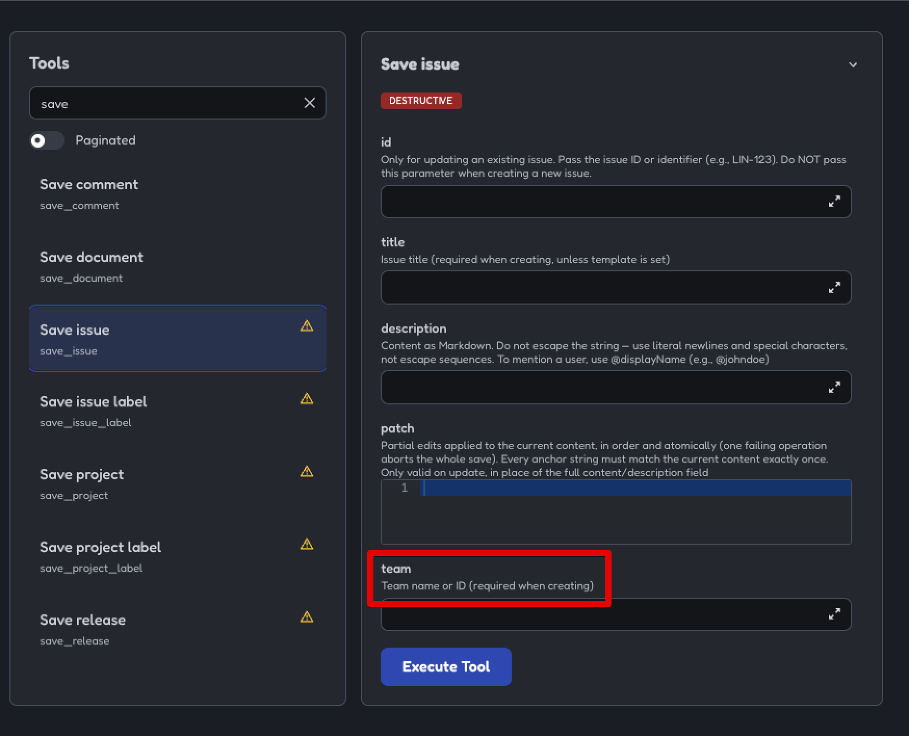
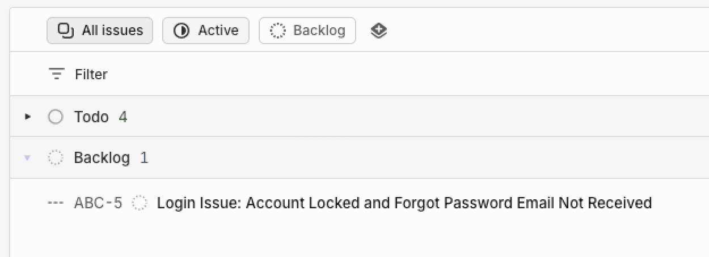

<!-- title: Streamhouse for AI Agents Part 1 of 3: Set up an LLM and MCP tool in Confluent Cloud -->
<!-- description: In this tutorial, learn how to set up models and MCP tools to be used in agentic AI workflows with Flink SQL in Confluent Cloud, with step-by-step instructions and supporting code. -->

# Streamhouse for AI Agents Part 1 of 3: Set up an LLM and MCP tool in Confluent Cloud

In Part 1 of this tutorial series, you'll set up and test the infrastructure and third-party services for an agentic AI use case: a listener that creates short tasks in a project management platform from customer communications. This is a good example of why models need tools. LLMs are good at summarizing a customer's message, but they don't know about your project management platform and can't connect to it on their own. You'll use Confluent Cloud's [Managed Model Inference](https://docs.confluent.io/cloud/current/ai/managed-model.html) to run an LLM, so there are no model provider accounts, endpoints, or API keys to set up, and [Linear](https://linear.app/) as the SaaS project management platform (the _tool_ for the model to call). Linear is similar to [Jira](https://www.atlassian.com/software/jira) or [Asana](https://asana.com/).

Automatic ticket creation is a good fit for an AI pipeline because a wrong answer costs little. If an agent creates a ticket by mistake or routes one incorrectly, a person can fix it later.

In [Part 2](https://developer.confluent.io/confluent-tutorials/agentic-ai-streaming-agent/flinksql/), you'll build and evolve a Streaming Agent for this use case. In [Part 3](https://developer.confluent.io/confluent-tutorials/agentic-ai-real-time-context/flinksql/) you'll further evolve the agent by grounding it with live business context from Kafka using the Real-Time Context Engine.

> **A note on how this tutorial relates to a broader [Streamhouse](https://streamhouse.com/) data architecture:** Streamhouse is an open, vendor-neutral category of data architectures that keep the current state of a business continuously available to production applications, analytics, and AI agents. It describes five stages: capture, transport, transform, govern, and serve. This series covers the part of that picture where an agent acts on business events as they happen instead of on data refreshed in batches. In this part, you set up the model and the tool that Flink SQL will call for each event. In Parts 2 and 3, customer communications and orders are records in Kafka topics (transport) with schemas registered in Schema Registry (govern), and Flink SQL invokes the agent on each new communication (transform). In Part 3, the Real-Time Context Engine (RTCE) serves current order data to the agent (serve) so that it can use the customer's membership level to decide how each support issue is prioritized.

## Prerequisites

- A [Confluent Cloud](https://confluent.cloud/signup) account
- The [Confluent CLI](https://docs.confluent.io/confluent-cli/current/install.html) installed on your machine
- [Node.js and npm](https://docs.npmjs.com/downloading-and-installing-node-js-and-npm) to inspect Linear's MCP server
- [`jq`](https://jqlang.org/download/) for parsing JSON on the command line

## Create Confluent Cloud resources

Log in to your Confluent Cloud account:

```shell
confluent login --prompt --save
```

Install a CLI plugin that streamlines resource creation in Confluent Cloud:

```shell
confluent plugin install confluent-quickstart
```

Run the plugin to create the Confluent Cloud resources this tutorial needs: a Kafka cluster and a Flink compute pool. You can choose a different cloud provider (`gcp` or `azure`) or region, but the Flink compute pool must be in a [region that supports Managed Model Inference](https://docs.confluent.io/cloud/current/ai/managed-model.html). To list the supported regions for a cloud provider, run `confluent kafka region list --cloud <CLOUD>`. The plugin takes under a minute.

```shell
confluent quickstart \
  --environment-name agentic-ai-env \
  --kafka-cluster-name agentic-ai-cluster \
  --compute-pool-name agentic-ai-pool
```

This tutorial uses the plugin only to create infrastructure, not client configuration files, so you'll see the following output when it finishes:

```plaintext
No config files were created (no resources were created)
Quickstart complete. Exiting.
```

## Set up Linear account and create credentials

[Sign up](https://linear.app/signup) for a free Linear account (no credit card required). During signup, Linear prompts you to create a workspace. Give it a unique name and select a region. Click through the quick start prompts until you reach your workspace home page.

You need a Linear API key to call Linear as an MCP tool from Confluent Cloud. To create one, click the workspace dropdown at the top left, then click `Settings`. Select `Security & access` in the left-hand navigation, then click `New API key` under `Personal API keys`. Give the key a name. Under `Permissions`, select `Only select permissions...` and check only `Read` and `Write`. Click `Create`, and save the API key.

## Create the Linear connection

To create an MCP tool in Confluent Cloud, you need a [connection](https://docs.confluent.io/cloud/current/flink/reference/statements/create-connection.html) to the external service. Managed Model Inference doesn't need a connection because Confluent hosts access to the model. In this step, you create the connection to Linear.

Start a Flink SQL shell:

```shell
confluent flink shell --compute-pool \
  $(confluent flink compute-pool list -o json | jq -r ".[0].id")
```

Create a connection to Linear's MCP server. Linear offers both streamable HTTP and SSE-based [MCP endpoints](https://linear.app/docs/mcp#general). Paste your Linear API key into the following statement to create a connection to Linear's streamable HTTP MCP server:

```sql
CREATE CONNECTION `linear-mcp-connection`
  WITH (
    'type' = 'MCP_SERVER',
    'endpoint' = 'https://mcp.linear.app/mcp',
    'transport-type' = 'streamable_http',
    'token' = '<LINEAR_API_KEY>'
  );
```

You'll see the following output when the connection is created:

```plaintext
Finished statement execution. Statement phase: COMPLETED.
The server returned empty rows for this statement.
```

Validate that the connection has been created:

```sql
SHOW CONNECTIONS;
```

You will see:

```plaintext
+-----------------------+
|    Connection Name    |
+-----------------------+
| linear-mcp-connection |
+-----------------------+
```

## Inspect the Linear MCP server

In this section, you'll inspect Linear's MCP server to see which tools it has and which parameters they require. You'll need this when you call the tool later.

Run the following command from your terminal (not the Flink shell) to start an MCP server inspection utility:

```shell
npx @modelcontextprotocol/inspector@latest
```

Click the `Add Servers` button. Enter `linear-mcp` as the `Server ID`, select `streamable-http` as the `Transport`, and enter `https://mcp.linear.app/mcp` as the `URL`. Then click `Add`.



Toggle the radio button where it says `Disconnected` to connect to the server.



Once you're connected, click `Tools` at the top of the page. These are the tools you can use in an agentic AI workflow. This tutorial focuses on issue creation, so click the `save_issue` tool to see the fields required to create an issue.



The tool has a required `team` field. To get your team ID (a GUID), run the following command in your terminal. Substitute your Linear API key:

```shell
curl \
  -X POST \
  -H "Content-Type: application/json" \
  -H "Authorization: <LINEAR_API_KEY>" \
  --data '{
    "query": "query Teams { teams { nodes { id name } }}"
  }' \
  https://api.linear.app/graphql | jq -r ".data.teams.nodes[0].id"
```

## Create models

In the Flink SQL shell, list the managed models available in your compute pool's region:

```sql
SHOW MODELS;
```

Managed models are the entries prefixed with `system.`. This tutorial uses an Anthropic Claude Sonnet model. If the `anthropic.claude-sonnet-4-6` model ID used below isn't listed, substitute the ID of another Claude Sonnet model from the output (without the `system.` prefix).

Create a model with the `confluent` provider. Anthropic models require `max_tokens` to be set explicitly, which you provide via the `confluent.params.max_tokens` option:

```sql
CREATE MODEL chat_listener
INPUT(prompt STRING)
OUTPUT(response STRING)
WITH (
  'provider' = 'confluent',
  'task' = 'text_generation',
  'confluent.model' = 'anthropic.claude-sonnet-4-6',
  'confluent.params.max_tokens' = '1024'
);
```

Next, create a similar model that also uses the MCP server connection. You'll use it to call Linear's `save_issue` tool in the next step. The `confluent.system_prompt` option tells the model to prefer calling a tool over answering directly:

```sql
CREATE MODEL linear_mcp_model
INPUT(prompt STRING)
OUTPUT(response STRING)
WITH (
  'provider' = 'confluent',
  'task' = 'text_generation',
  'confluent.model' = 'anthropic.claude-sonnet-4-6',
  'confluent.params.max_tokens' = '1024',
  'confluent.system_prompt' = 'Use the best tool to respond to the input prompt',
  'mcp.connection' = 'linear-mcp-connection'
);
```

Validate that both models have been created:

```sql
SHOW MODELS;
```

In addition to the `system.` managed models, you will see your two models:

```plaintext
+------------------+
|    Model Name    |
+------------------+
| chat_listener    |
| linear_mcp_model |
| system....       |
+------------------+
```

## Test models and tool invocation

First, test the base LLM that doesn't call any tools:

```sql
SELECT
  prompt,
  response
FROM
  (SELECT 'What is a good family friendly dog breed? Answer concisely with only the most recommended breed.' AS prompt) t,
LATERAL TABLE(AI_COMPLETE('chat_listener', prompt)) AS r(response);
```

You should see output like the following. It can take 10 to 15 seconds to appear. Your output may differ because the model is nondeterministic.

```plaintext
prompt                                           response
what is a good family friendly dog breed? ...    Labrador Retriever
```

Next, test the MCP tool call. Substitute your Linear team ID:

```sql
SELECT
  AI_TOOL_INVOKE(
    'linear_mcp_model',
    'Create an issue from the following text using <LINEAR_TEAM_ID> as the team ID. I can''t log in to the online store. It says that my account has been locked out. When I try the forgot password route, I don''t get an email to reset it. Please help!',
    MAP[],
    MAP['save_issue', 'Save issue'],
    MAP[]
  ) AS response;
```

You should see a JSON response with the status and the action taken. In the [Linear web app](https://linear.app/), click `All issues`. You'll see a new ticket in the backlog that summarizes the issue:



## Next steps

You've created the models and tool and confirmed they work. Continue to [Part 2](https://developer.confluent.io/confluent-tutorials/agentic-ai-streaming-agent/flinksql/) of this tutorial series.

## Clean up

If you aren't continuing to Part 2, delete the `agentic-ai-env` environment to clean up the Confluent Cloud infrastructure created for this tutorial. Run the following command in your terminal to get the environment ID of the form `env-123456` corresponding to the environment named `agentic-ai-env`:

```shell
confluent environment list
```

Delete the environment:

```shell
confluent environment delete <ENVIRONMENT_ID>
```
